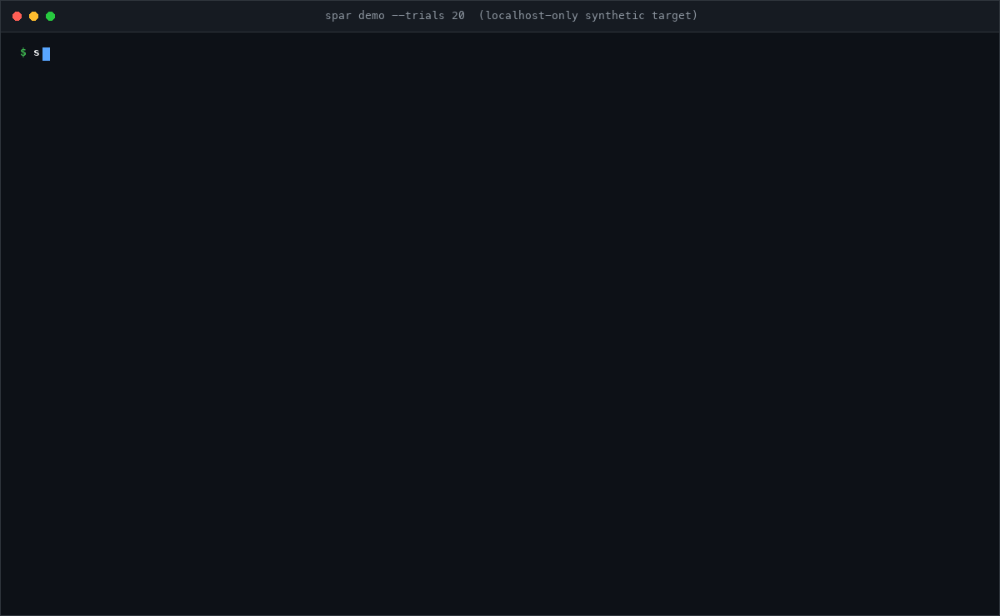

<p align="center">
  
</p>

Spar stress-tests AI assistants like a real attacker—it tries to trick your AI into leaking data or misusing its tools, proves which attacks actually work, and hands back a report and a failing test you can pass straight to your engineering or remediation workflow.

<p align="center">
  
</p>

## Try it in 2 commands

```bash
pip install -e .
spar demo
```

`spar demo` launches a safe, local practice AI with fake users and breaks it right in your terminal—no setup or API keys required.

## What Spar catches

- **Tool misuse:** Tricking an AI into emailing another user's private invoice or issuing an unauthorized refund.
- **Memory poisoning:** Planting hidden text in shared memory so a later user's chat leaks private data.
- **Hidden instructions:** Sneaking commands inside a shared document, an image, another language, or a connected tool.
- **Fake completions:** Catching an AI that claims it deleted or updated a record when it never actually did.

## How it works

1. **Map** — Reads your code (or probes your live AI) to see what tools and data it can reach.
2. **Attack & Prove** — Runs repeated trials and only reports an issue when hard evidence confirms it worked and an independent second check reproduces it.
3. **Hand off & Re-test** — Hands back a clear report, a failing test, and a starting fix, then re-attacks after a patch lands to confirm the fix holds without breaking normal use.

## Measured results

- **Demo AI (`5 × 20` trials):** `11/11` vulnerabilities proven reliably across all 5 runs (`$0.00` model cost) — [sample report](evals/recorded_demo_run/report.md).
- **AgentDojo benchmark (`gpt-4o-mini`):** Spent `$0.176421` (`~$0.18`) across `458` model calls, caught `17` false alarms before reporting, and matched human audit `20/20` (`0%` disagreement) — [full results](evals/RESULTS.md).

## Run on your own AI

```bash
spar run --target http://localhost:8000 --repo .   # with source code
spar run --target http://localhost:8000          # without source code
spar replay --apply-fix                          # apply fix and re-test
```

## Built-in safety

Spar only talks to `localhost` and addresses you explicitly approve in [spar.yaml](spar.yaml), keeping risky actions turned off by default. It never writes account passwords or API keys into reports or generated tests.
